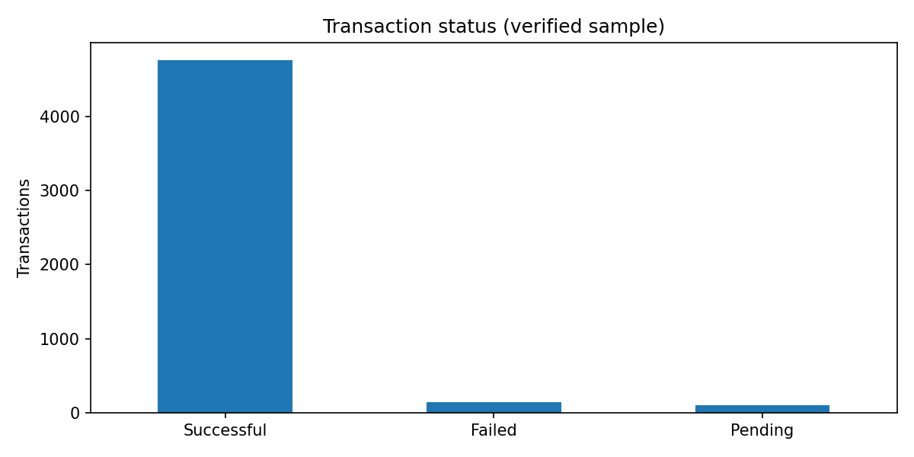
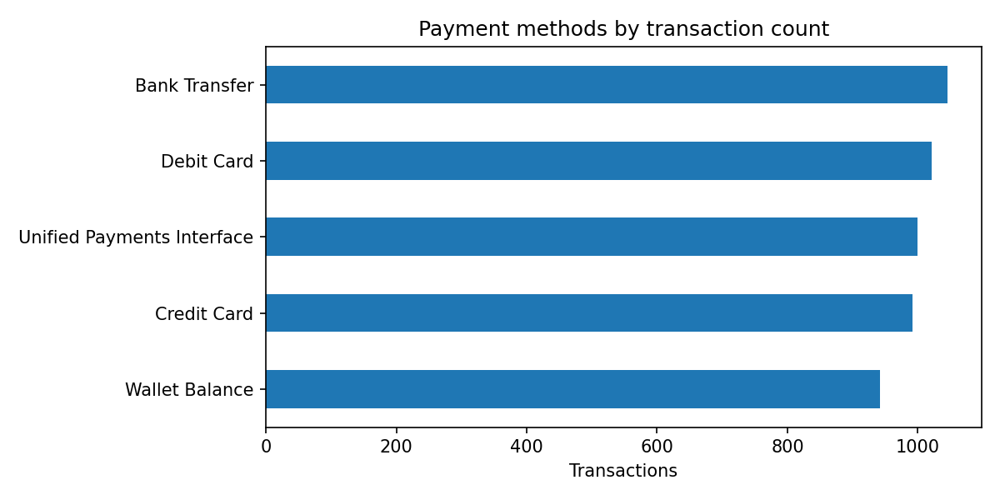

# Digital Payments | Data Cleaning & SQL Analysis

**Python · Pandas · SQLite · Exploratory Data Analysis**

This repository documents my DEPI Digital Egypt Pioneers Initiative data analysis project. I worked on a digital-payment transactions dataset with missing values, duplicate rows, and inconsistent categories. The aim was to prepare reliable data for analysis and explore customer transaction patterns.

> **Portfolio update:** The `scripts/`, `sql/`, and verified dataset files in this repository are a *reproducible cleanup and analysis refresh* of the original project. The original 2024 Colab notebooks can be added separately; see [`notebooks/README.md`](notebooks/README.md). This is a demonstration dataset, and the findings should not be generalized to the real payments industry.

## Project at a glance

| Metric | Value |
| --- | ---: |
| Original rows | **5,499** |
| Original columns | **14** |
| Exact duplicate rows detected and removed | **500** |
| Unique records after deduplication | **4,999** |
| Missing category, amount, fee and location values after deduplication | **539 in each column** |
| Remaining null values in verified cleaned output | **0** |
| Remaining exact duplicate rows | **0** |

## Business questions

- What payment methods are used most often in the sample?
- Which categories have the largest transaction volumes?
- How do successful, failed and pending transactions compare?
- How are transaction volumes distributed across merchants, device types and locations?

## Data cleaning workflow

1. **Understand the raw data:** Inspect columns, data types, missing values, summary statistics and duplicates.
2. **Remove exact duplicate rows:** Remove 500 duplicates from the 5,499-row input.
3. **Fix product categories:** Infer missing categories from the *product name* only where existing labels are unambiguous. Unlike a merchant-wide replacement, this preserves cases where a merchant supports different transaction categories.
4. **Impute missing numerical values:** Fill missing `product_amount` and `transaction_fee` using each product's average, rounded to two decimals.
5. **Fill missing locations:** Use the most frequent location in this sample.
6. **Standardize payment methods:** Convert `UPI` to `Unified Payments Interface`.
7. **Normalize dates:** Save dates in sortable ISO format to support SQL queries.
8. **Validate the output:** Confirm no missing values and no exact duplicate rows remain.

The original course notebook included manual category mapping and later joined a 500-row extract back onto the cleaned data. During the 2026 portfolio review, that later output was found to contain duplicated transactions. This repository uses the **verified 4,999-row dataset** instead of treating the merged 5,499-row export as the final clean version.

## Sample findings from the verified dataset

- **4,754 of 4,999 transactions** (about **95.1%**) are labeled `Successful`.
- **Bank Transfer** is the most frequent payment method (**1,045 transactions**), followed by **Debit Card** (**1,021**).
- **Streaming Service** is the most frequent product category (**299 transactions**).

These are descriptive results from the sample. They do not establish cause and effect.

## Visual overview





*These two charts were created as part of the 2026 GitHub portfolio refresh, not copied from the original 2024 presentation.*

## Repository structure

```text
DEPI-final-project/
├── README.md
├── requirements.txt
├── data/
│   ├── raw/modified_csv_with_problems.csv
│   └── processed/digital_payments_cleaned_verified.csv
├── scripts/
│   ├── clean_transactions.py
│   └── build_database.py
├── sql/
│   ├── 01_create_table.sql
│   └── 02_analysis_queries.sql
├── database/
│   └── digital_payments_verified.db
├── assets/
│   ├── status_breakdown.png
│   └── payment_methods.png
└── notebooks/
    └── README.md
```

The repository may also contain my earlier `Data Analysis Workshop.pptx` upload.

## How to run the updated workflow

```bash
pip install -r requirements.txt
python scripts/clean_transactions.py
python scripts/build_database.py
```

Open `database/digital_payments_verified.db` using DB Browser for SQLite, then run the queries from `sql/02_analysis_queries.sql`.

## Notes on data quality and limitations

- The source does not include a unique transaction ID, so exact duplicate rows are removed as part of this exercise; there is no independent way to confirm that every identical row is an invalid transaction.
- Filling numerical values with product-level averages makes the dataset complete, but those values are **estimates**, not observed transactions.
- Filling location with the mode may bias location-based comparisons.
- User IDs are pseudonymous in the provided dataset; check the data-sharing rights before making source files public.

## Context

Project from the **Digital Egypt Pioneers Initiative (DEPI)** data-analysis program. This public repository is intended to demonstrate my data cleaning, SQL, and analytical documentation skills.
